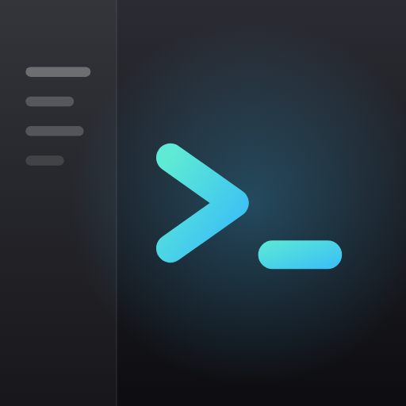
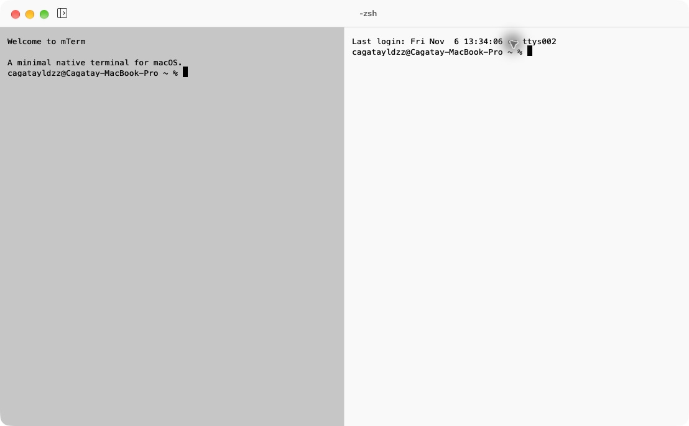
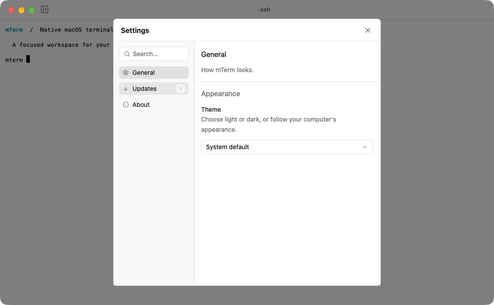

#  mTerm

A minimal native terminal for macOS, built with Rust and [GPUI](https://gpui.rs).

| Terminal | Settings |
| --- | --- |
|  |  |

mTerm brings tabs and split panes together in a focused workspace and picks up where
you left off: windows, tabs, splits and folders return on the next launch. Search the
scrollback with ⌘F and choose a theme and font in Settings.

## Get started

mTerm supports macOS 15 or later on Apple Silicon. Download the latest build from
[GitHub Releases](https://github.com/cagatayldzz/mTerm/releases), or follow the
[development guide](docs/development.md) to build it locally.

Open **Settings** with `⌘,` to change the appearance or check for updates. See the
[usage guide](docs/usage.md) for keyboard shortcuts and opening folders from other apps.

## Documentation

- [Usage](docs/usage.md) — shortcuts, mouse, integrations, updates
- [Development](docs/development.md) — platform, commands, packages, tests
- [Architecture](docs/architecture.md) — code map, data flow, persistence
- [Releasing](docs/releasing.md) — release process
- [Project rules](AGENTS.md) — conventions for contributors and AI agents
