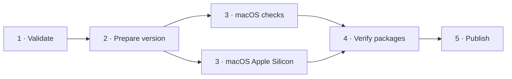

# Releasing

CI runs script tests and formatting on Ubuntu for every push to `main` and pull
request, plus lint and tests for the terminal and storage crates (the GPUI crates
need macOS, so the release workflow checks them). A newer push cancels outdated CI runs.
To publish a release, run `bun run release` from a clean `main` (requires
`gh auth login`), or start **Actions → Release** manually.

The version bump is derived from commit messages since the last tag
(`feat:` → minor, `type!:` / `BREAKING CHANGE:` → major, otherwise patch).
Release notes are generated from commit titles with OpenAI. The build produces a
macOS Apple Silicon ZIP, signed with Developer ID and notarized, and a
`SHA256SUMS.txt`. Nothing is published unless the checks and the build pass.

The release graph follows the work order. Validation finishes before version
preparation or the build starts. The workspace is linted and tested in a parallel
job so the GPUI tree is not compiled twice, and only verified artifacts reach
publication.

Required repository secrets:

| Secret | Purpose |
| --- | --- |
| `OPENAI_API_KEY` | Release notes |
| `APPLE_CERTIFICATE_BASE64` | Base64-encoded Developer ID Application `.p12` |
| `APPLE_CERTIFICATE_PASSWORD` | Password for the `.p12` |
| `APPLE_ID` | Apple Developer account email |
| `APPLE_TEAM_ID` | Team identifier |
| `APPLE_APP_SPECIFIC_PASSWORD` | App-specific password for notarization |

See [platform support](platform-support.md) for the supported systems.
